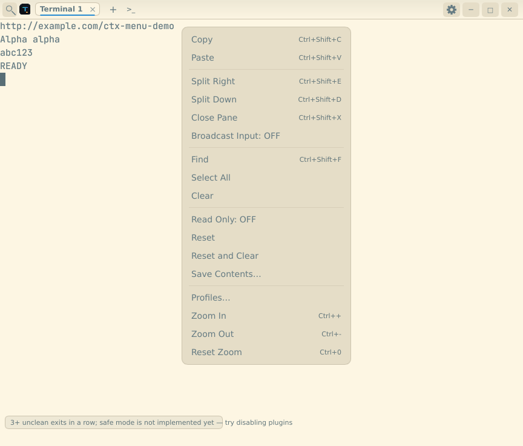
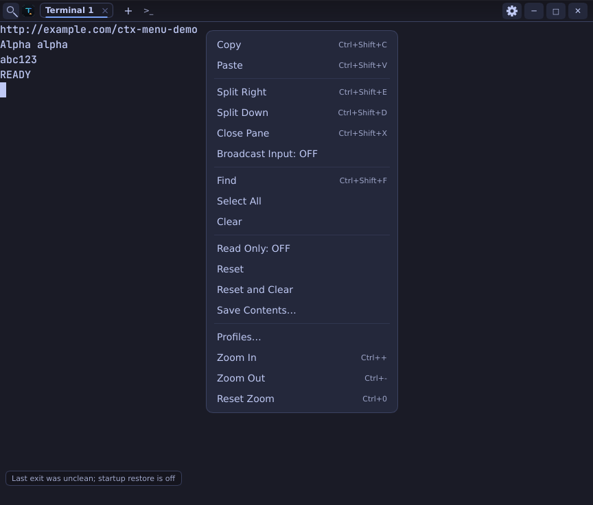

<p align="center">
  
</p>

# xtervo

[简体中文](README.md) | **English**

A native terminal emulator written in Rust + Slint: GPU rendering (Skia / wgpu with
automatic software fallback), built to make everyday terminal work smooth, fast and
light — low memory, low input latency, scriptable control.
Interaction and product decisions are informed by Tabby and other modern terminals;
xtervo does not aim to replace Tabby, clone it pixel-for-pixel, or be plugin-compatible.

> **How it is built**: this project is developed entirely by **DeepSeek + DeepSeek
> Harness** (code, tests and documentation).
> **Tested on**: only **Ubuntu 22.04 / 24.04** so far; other distributions and desktop
> environments are unverified.
> **Try it**: if something feels off, you find a bug, or you want a feature, please
> [open an issue](https://github.com/HeyTycho/xtervo/issues).

> **Independent project**: xtervo is not affiliated with, sponsored by, or endorsed by
> the authors of Tabby / Terminus. “Tabby” is a trademark of its owner; it is mentioned
> here only for feature reference and interoperability notes. No Tabby code or artwork
> is included.

| Light | Dark |
|---|---|
|  |  |

## Features

**Terminal core**

- VT220 / xterm compatibility: wide characters and CJK, emoji ZWJ sequences, combining
  characters, 24-bit color, alternate screen, mouse reporting (1000/1002/1003/1006)
- Inline images: Sixel, iTerm2 IIP (OSC 1337), Kitty graphics (source crop and placement)
- Search (case-sensitive/regex), double-click word selection, triple-click line
  selection, copy/paste with bracketed paste, URL and file-path clicking
- Scrollback and scrollbar, in-screen zoom (`Ctrl+±`), Shell Integration
  (OSC 133/7: command boundaries, exit status, current directory)
- Keyboard: kitty keyboard protocol, multi-stage shortcuts, Caps/Num Lock state,
  IME candidate window anchored to the real cursor

**Workspace**

- Tabs (rename/undo, MRU stack, close-range shortcuts, session restore) + splits
  (drag to rearrange, zoom, confirmation for dangerous broadcast input)
- Named workspaces: save the current split layout and restore it later
  (`workspace.save` / `workspace.open`)
- Sidebar (profiles, status pill), command palette (`Ctrl+Shift+P`), hotkey settings
- Multi-window: several windows in one process, close confirmation, layout restore
  after exit

**Connections and plugins** (optional; works as a plain local terminal without them)

- Profiles: local shell (multiple profiles in one window), SSH, Serial, Telnet;
  startup failures and disconnects are visible
- SSH: system `ssh` path + **official plugin POC** (`Backend::Plugin` transport seam);
  known_hosts, port forwarding, ProxyJump
- Plugin API v3: external processes + JSON-RPC; commands/hotkeys/`when` contexts,
  status bar, declarative panels and settings, context-menu decoration points
- Vault: encrypted credentials and SSH password askpass; MCP: live control and offline
  diagnostics over a Unix socket

**Reliability**

- Session snapshots (atomic write + `.bak` fallback), unclean-exit detection,
  consecutive-crash counter, safe mode (plugins are not loaded after ≥3 unclean exits)
- Memory gates: 2m/15m soak baselines with RSS/PSS, thread and FD tracking; release
  packages come with checksums

## Installation

### From a release

Prebuilt artifacts are published on [GitHub Releases](https://github.com/HeyTycho/xtervo/releases):

| Artifact | Purpose |
|---|---|
| `xtervo-<version>-linux-x86_64.tar.gz` | Extract and run `install.sh`; installs to `~/.local` by default, `--prefix` overrides |
| `xtervo_<version>-1_amd64.deb` | Debian / Ubuntu package; `apt install ./...deb` resolves dependencies |
| `SHA256SUMS` | SHA-256 checksums for the downloaded artifacts |

```bash
# verify what you downloaded (only files present in the directory)
sha256sum -c --ignore-missing SHA256SUMS

# option 1: tar.gz (default prefix ~/.local)
tar xzf xtervo-<version>-linux-x86_64.tar.gz
./xtervo-<version>-linux-x86_64/install.sh

# option 2: .deb
sudo apt install ./xtervo_<version>-1_amd64.deb
```

Artifacts are named after the build architecture: x86_64 maps to `amd64` in `.deb`,
aarch64 maps to `arm64`.

### Build from source

Ubuntu / Debian build dependencies:

```bash
sudo apt install build-essential pkg-config cmake ninja-build ca-certificates curl libudev-dev \
  libxkbcommon-dev libx11-dev libxcursor-dev libxrandr-dev libxi-dev \
  libgl1-mesa-dev libegl1-mesa-dev libfontconfig1-dev libfreetype6-dev
```

```bash
git clone https://github.com/HeyTycho/xtervo.git
cd xtervo
cargo build --release -p xtervo-app
./target/release/xtervo --cols 120 --rows 32
```

By default Cargo uses `~/.cargo`. If that directory is read-only (sandbox/CI), point it
inside the repository instead:

```bash
export CARGO_HOME=$PWD/.cargo
```

Runtime: Linux (X11; Wayland through XWayland), Rust 1.92+, Slint 1.18.
With `/dev/dri` xtervo uses the GPU (Skia); otherwise it falls back to `winit-software`.

### Packaging and install scripts

```bash
./scripts/package.sh                  # → dist/ (binary + tar.gz + .deb + SHA256)
./scripts/install.sh                  # install to $PREFIX (default ~/.local)
./scripts/install.sh --rollback       # roll back to the previous version
./scripts/test_packaging.sh           # package + clean-prefix install + upgrade/rollback/uninstall
```

See [`docs/RELEASING.md`](docs/RELEASING.md) and [`packaging/README.md`](packaging/README.md)
for the release process and reproducible-build details.

## Usage

Start `xtervo`. Configuration and profiles live in `~/.config/xtervo/`
(`config.toml`, `profiles.toml`, `workspaces.toml`); logs and state live in
`~/.local/state/xtervo/`.

Common shortcuts (all rebindable in Settings → Keys):

| Action | Shortcut |
|---|---|
| Command palette | `Ctrl+Shift+P` |
| New / close tab | `Ctrl+Shift+T` / `Ctrl+Shift+W` (`Ctrl+W` is left to the shell for word deletion) |
| Previous / next tab | `Ctrl+PageUp` / `Ctrl+PageDown` |
| Move tab left / right | `Ctrl+Shift+PageUp` / `Ctrl+Shift+PageDown` |
| Tabs 1–10 | `Alt+1` … `Alt+9` / `Alt+0` |
| Split right / down | `Ctrl+Shift+E` / `Ctrl+Shift+D` |
| Copy / paste | `Ctrl+Shift+C` / `Ctrl+Shift+V` |
| Find | `Ctrl+Shift+F` |
| Sidebar | `Ctrl+Shift+B` |
| Zoom / restore pane | `Ctrl+Shift+M` |
| Zoom in/out / reset | `Ctrl+=` `Ctrl+-` / `Ctrl+0` |
| Fullscreen | `F11` |

Other entry points: `xtervo --restore` restores the previous layout;
`xtervo diag env|snapshot|trace` provides offline diagnostics; MCP control is documented
in [`docs/MCP.md`](docs/MCP.md).

## Documentation

The detailed documentation lives in **[`docs/README.md`](docs/README.md)** (Chinese
index); an English index with one-line descriptions is available at
**[`docs/README.en.md`](docs/README.en.md)**. Most design documents are currently
written in Chinese — English translations are welcome.

- Getting started: [architecture](docs/ARCHITECTURE.md) · [product principles & roadmap](docs/PRODUCT_PRINCIPLES.md) · [UI design](docs/UI_DESIGN.md)
- Guides: [plugin installation](docs/PLUGIN_INSTALL.md) · [plugin API v3](docs/PLUGIN_V3.md) · [SSH/SFTP](docs/SSH_SFTP.md) · [Vault](docs/VAULT.md) · [MCP](docs/MCP.md) · [diagnostics](docs/DIAGNOSTICS.md) · [soak](docs/SOAK.md)
- Design & internals: [transport plugins](docs/PLUGIN_TRANSPORT.md) · [workspace shell](docs/WORKSPACE_SHELL.md) · [image compositing](docs/IMAGE_COMPOSITING.md) · [multi-window](docs/MULTI_WINDOW_ARCHITECTURE.md)
- Status & reports: [feature matrix](docs/FEATURE_MATRIX.md) · [closure report](docs/CLOSURE.md) · [scope review](docs/SCOPE_REVIEW.md) · [performance](docs/PERFORMANCE.md) · [mainline status](docs/MAINLINE_STATUS.md)
- Archive: [docs/archive/](docs/archive/) (historical reports and one-off analyses)

## Development

```bash
cargo test -p xtervo-core                 # core unit tests + VT contract
cargo test -p xtervo-app --bin xtervo      # app unit tests
./scripts/selfcheck.sh                   # build + tests + startup budget (RUN_IME=1 adds a CJK smoke test)
./scripts/soak.sh                        # 2m/15m memory gate (DURATION=15m)
python3 scripts/e2e_split_repaint.py      # pixel-level split repaint e2e
python3 scripts/check_docs_counts.py     # documentation count reconciliation (before release)
python3 scripts/check_doc_links.py       # relative-link check for docs
```

Development rules are in [`AGENTS.md`](AGENTS.md) (large tasks after 18:00; every change
needs a failing test or evidence; long gates at 2m/15m/30m). Contribution process:
[CONTRIBUTING.md](CONTRIBUTING.md) (English: [CONTRIBUTING.en.md](CONTRIBUTING.en.md)).
Changelog: [`CHANGELOG.md`](CHANGELOG.md).

- In-app: brand icon on the left of the tab bar, settings title icon
  (`assets/icon-small.png`).
- Window/taskbar icon: `_NET_WM_ICON` is written directly by the Rust side
  (`assets/icon-64.rgba`), because Slint's built-in `Window.icon` ends up as an empty
  property in this environment.

## Known limitations

- Terminal glyph rasterization is still CPU-based (fontdue), but uses double-buffered
  persistent frames: `Image` is only a refcount clone, no per-frame full
  `SharedPixelBuffer` copy; Skia still uploads the frame as a texture before compositing.
  With `/dev/dri` it uses Skia/GL by default; without DRM or if no GPU API is confirmed
  within 1s it falls back to `winit-software`. Real NVIDIA GPU frame-rate/latency data
  is still waiting for user re-testing.
- Tabs cannot be reordered by dragging. Splits already support divider dragging and
  window-edge resizing.
- Native file drag-and-drop bridging currently covers X11/winit only: Slint 1.18.1's
  winit backend does not translate `HoveredFile`/`DroppedFile` into `DataTransfer`, and
  winit 0.30.13's Wayland backend has no DnD implementation. Native Wayland explicitly
  does not support it (no fake hover). The visual bell does not follow the system's
  reduced-motion setting yet.
- Window position/size: X11 is managed by the app layer; native Wayland does not allow
  clients to set global positions, so `set_position` is a no-op and Quake mode is
  unavailable (startup/settings say so explicitly). Wayland session snapshots only
  store the size (`position_known=false`), so they never pollute the next X11 restore
  with `(0,0)`.
- Clipboard/PRIMARY: works on X11 and on “Wayland window + XWayland”; pure Wayland needs
  the compositor to provide ext-/wlr-data-control, which GNOME/Mutter 46 does not, and a
  readable reason is printed once on failure.
- Window icon: X11 uses runtime `_NET_WM_ICON`; Wayland associates the installed
  `xtervo.desktop` with `app_id=xtervo`, and no icon is written at runtime.
- Fonts are fixed to JetBrains Mono (falling back to DejaVu); Chinese automatically falls
  back to WenQuanYi Micro Hei / Droid / Noto CJK. Color emoji are enabled by default
  (Noto Color Emoji CBDT/CBLC/sbix; disable with `XTERVO_COLOR_EMOJI=0`). Custom fonts
  and ligatures are not supported yet; COLR/SVG color emoji still fall back to
  monochrome/placeholder.
- IME: X11 uses winit's XIM (fcitx5 / ibus); native Wayland uses text-input-v3. Chinese
  input has been tested with GNOME 46 + fcitx5 (pinyin); other compositors/IMEs still
  need matrix testing. More Wayland limitations and verification details are in
  `docs/WAYLAND_ADAPTATION.md`.
- Theme following the system depends on GNOME `gsettings`; non-GNOME environments fall
  back to `gtk-theme` / `COLORFGBG` for a one-shot detection.
- Custom themes are still scanned at startup; editing a theme file requires a restart
  (hot reload is not implemented).
- Settings currently has no font-family/line-height controls; search jumps to the
  settings card rather than an individual control, and keyboard focus traversal
  (Tab/arrows) is still mostly mouse/search driven. The legacy modal is the same set of
  controls in a different presentation, not the pre-2026-11 implementation.
- Session snapshots restore layout/geometry/title/cwd/profile association and pinned
  tabs, but not scrollback, screen contents, or running processes.
  With `restore_session_on_startup=true` autosave runs every 2s; unclean exits are
  detected via a running marker and restored. Session v2 stores geometry/maximized/
  active_tab/tabs for all windows; a corrupt primary falls back to the previous `.bak`.
  SSH/Serial/Telnet do not reconnect automatically.
- SSH/Serial/Telnet profiles are not reconnected by session restore (the user must open
  them explicitly, avoiding connections at startup); they are restored as a plain shell
  with the tab title/layout/cwd preserved.
- Tab pin means “pin to the left pinned area”, not “always on top”. Order can still be
  changed within the pinned group, but tabs cannot cross into the unpinned group;
  dragging a tab out of the window or between windows is not implemented.
- Profile appearance overrides are per-pane “pins”: after a profile sets them, global
  font-size/theme/cursor changes do not refresh that pane; clearing the profile field
  and opening a new tab returns to inheritance.
- Packaging/release: auto-update, crash reporting/upload, AppImage/Flatpak/Snap, release
  signing and an APT repository are not implemented and have no buttons. Upgrades go
  through the new tar's `install.sh` or a new `.deb`; rollback uses
  `install.sh --rollback`. See [`packaging/README.md`](packaging/README.md).

## Feedback and feature requests

- Bugs, feature requests, and usability feedback are welcome in
  [Issues](https://github.com/HeyTycho/xtervo/issues).
- For security issues, do not open a public issue; report privately as described in
  [SECURITY.md](SECURITY.md) (English: [SECURITY.en.md](SECURITY.en.md)).
- Please include: `xtervo --version`, distribution and desktop (X11 / Wayland), steps to
  reproduce, and relevant logs (`~/.local/state/xtervo/logs/`). Issues that reproduce
  reliably are fixed first.
- xtervo has only been tested on Ubuntu 22.04 / 24.04. Reports from other systems are
  welcome; fixes are scheduled by reproducibility.
- The most useful verification help right now: real Wayland + fcitx5/RIME input, non-GNOME
  desktops, and rendering/memory data on different GPUs/drivers.

## License

GPL-3.0-only, see [`LICENSE`](LICENSE). Third-party components and trademark notices are
in [`THIRD_PARTY_NOTICES.md`](THIRD_PARTY_NOTICES.md) and
[`docs/LICENSING.md`](docs/LICENSING.md).
