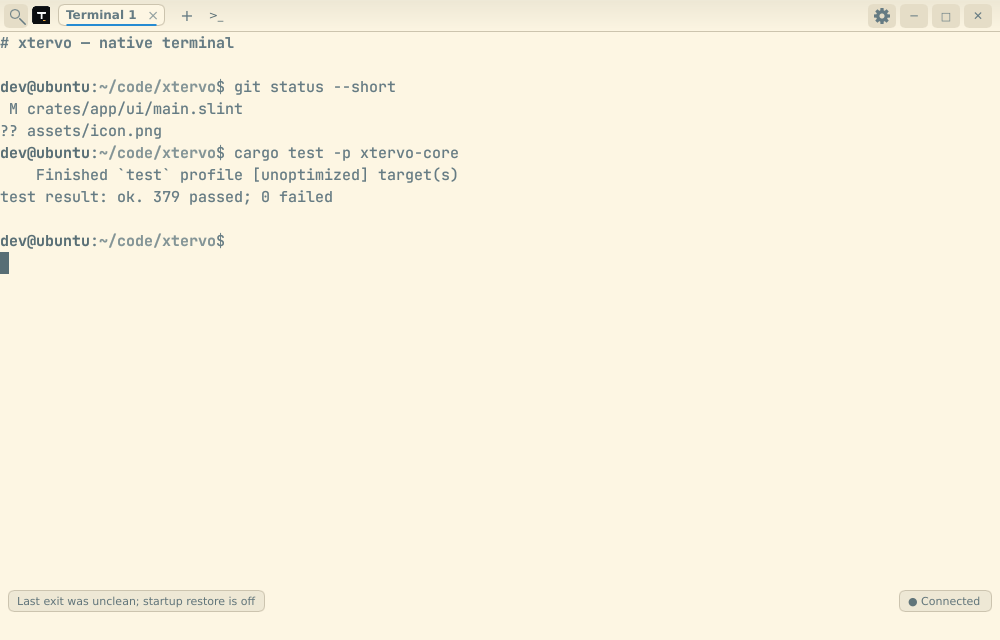
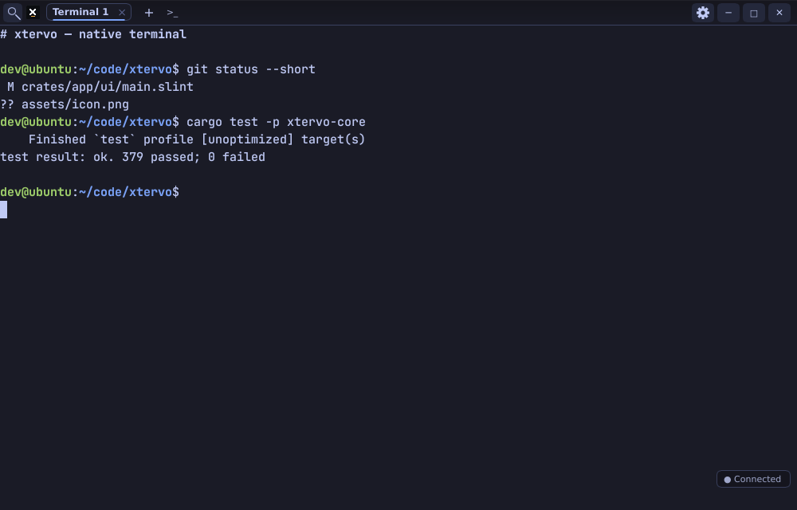

<p align="center">
  <picture>
    <source media="(prefers-color-scheme: dark)" srcset="assets/lockup-dark.png">
    
  </picture>
</p>

[English](README.en.md) | **简体中文**

> **文档站**：[中文](https://heytycho.github.io/xtervo/) · [English](https://heytycho.github.io/xtervo/en/)
> （可搜索、深/浅色、逐页切换语言）

用 Rust + Slint 写的原生终端模拟器：GPU 渲染（Skia / wgpu，无 GPU 自动回退软件光栅化），
目标是把日常终端做得顺滑、快、轻——低内存、低输入延迟、可脚本化控制。
交互和产品取舍参考过 Tabby 等现代终端；xtervo 不追求替代、像素级复刻或插件兼容。

> **开发方式**：本项目完全由 **DeepSeek + DeepSeek Harness** 完成（代码、测试与文档）。
> **测试范围**：目前只在 **Ubuntu 22.04 / 24.04** 上做过实机测试，其他发行版/桌面环境尚未验证。
> **欢迎试用**：用着不顺手、发现 bug，或有想要的功能（许愿），都欢迎到
> [Issues](https://github.com/HeyTycho/xtervo/issues) 反馈。

> **独立项目**：xtervo 与 Tabby / Terminus 的作者及项目无隶属、赞助或背书关系。
> “Tabby”是其权利人的商标，本项目仅在功能参考与互操作说明中提及；不含 Tabby 的代码或美术资源。

| 浅色 | 深色 |
|---|---|
|  |  |

## 主要功能

**终端核心**

- VT220 / xterm 兼容：宽字符与 CJK、emoji ZWJ 合并、组合字符、24 位色、备用屏、鼠标上报（1000/1002/1003/1006）
- 内联图片：Sixel、iTerm2 IIP（OSC 1337）、Kitty graphics（含源裁剪与 placement）
- 查找（大小写/正则）、双击选词/三击选行、复制粘贴（bracketed paste）、超链接与文件路径点击
- 滚动历史与滚动条、屏内缩放（`Ctrl+±`）、Shell Integration（OSC 133/7：命令边界、退出码、当前目录）
- 键盘：kitty keyboard protocol、多段快捷键、Caps/Num Lock 状态、IME 候选框跟随真实光标

**工作区**

- 标签页（重命名/撤销、最近使用栈、关闭范围快捷键、会话恢复）+ 分屏（拖拽重排、放大、广播输入的危险命令确认）
- 命名工作区：把当前分屏布局存为条目，之后一键恢复（`workspace.save` / `workspace.open`）
- 侧栏（Profile 常驻入口、状态区 pill）、命令面板（`Ctrl+Shift+P`）、快捷键设置页
- 多窗口：单进程多窗口、关闭前确认、退出恢复布局

**连接与插件**（可选，不装也能当纯本地终端用）

- Profile：本地 shell（多 Profile 同窗混用）、SSH、Serial、Telnet；启动失败/断线可见状态
- SSH：系统 `ssh` 路径 + **官方插件 POC**（`Backend::Plugin` transport seam）；known_hosts、端口转发、ProxyJump
- 插件 API v3：外部进程 + JSON-RPC；命令/快捷键/`when` 上下文、状态栏、声明式面板与设置、右键菜单装饰点
- Vault：加密凭据与 SSH 密码 askpass；MCP：Unix socket 上的实时控制与离线诊断

**可靠性**

- 会话快照（原子写 + `.bak` 回退）、异常退出检测、连续崩溃计数、safe mode（≥3 次异常退出时本次不加载插件）
- 内存门禁：2m/15m soak 基线，RSS/PSS、线程/FD 全程记录；release 打包带校验和

## 安装

### 从 Release 安装

预编译产物发布在 [GitHub Releases](https://github.com/HeyTycho/xtervo/releases)：

| 产物 | 用途 |
|---|---|
| `xtervo-<version>-linux-x86_64.tar.gz` | 解压后运行 `install.sh`；默认装到 `~/.local`，`--prefix` 可改 |
| `xtervo_<version>-1_amd64.deb` | Debian / Ubuntu 安装包；`apt install ./...deb` 会自动处理依赖 |
| `SHA256SUMS` | 下载产物的 SHA-256 校验和 |

```bash
# 在下载目录里先校验（只校验已下载的产物）
sha256sum -c --ignore-missing SHA256SUMS

# 方式一：tar.gz（默认 prefix ~/.local）
tar xzf xtervo-<version>-linux-x86_64.tar.gz
./xtervo-<version>-linux-x86_64/install.sh

# 方式二：.deb
sudo apt install ./xtervo_<version>-1_amd64.deb
```

Release 产物按构建机架构命名：x86_64 对应 `.deb` 的 `amd64`，aarch64 对应 `arm64`。

### 从源码构建

Ubuntu / Debian 构建依赖：

```bash
sudo apt install build-essential pkg-config cmake ninja-build ca-certificates curl libudev-dev \
  libxkbcommon-dev libx11-dev libxcursor-dev libxrandr-dev libxi-dev \
  libgl1-mesa-dev libegl1-mesa-dev libfontconfig1-dev libfreetype6-dev
```

```bash
git clone https://github.com/HeyTycho/xtervo.git
cd xtervo
cargo build --release -p xtervo-app
./target/release/xtervo --cols 120 --rows 32
```

默认使用 `~/.cargo`。沙箱 / CI 里 `~/.cargo` 只读时，可改用仓库内目录：

```bash
export CARGO_HOME=$PWD/.cargo
```

运行环境：Linux（X11；Wayland 通过 XWayland），Rust 1.92+，Slint 1.18。
有 `/dev/dri` 时默认 GPU（Skia），否则自动回退 `winit-software`。

### 打包与安装

```bash
./scripts/package.sh                  # → dist/（二进制 + tar.gz + .deb + SHA256）
./scripts/install.sh                  # 安装到 $PREFIX（默认 ~/.local）
./scripts/install.sh --rollback       # 回滚到上一版
./scripts/test_packaging.sh           # 打包 + 干净 prefix 安装 + 升级/回滚/卸载验证
```

发布流程、可复现构建细节见 [`docs/RELEASING.md`](docs/RELEASING.md) 与
[`packaging/README.md`](packaging/README.md)。

## 使用

启动 `xtervo`；配置与 Profile 在 `~/.config/xtervo/`（`config.toml`、`profiles.toml`、
`workspaces.toml`），日志与状态在 `~/.local/state/xtervo/`。

常用快捷键（全部可在 设置 → 快捷键 里改）：

| 操作 | 快捷键 |
|---|---|
| 命令面板 | `Ctrl+Shift+P` |
| 新建 / 关闭标签页 | `Ctrl+Shift+T` / `Ctrl+Shift+W`（`Ctrl+W` 留给 shell 删词） |
| 上 / 下一个标签页 | `Ctrl+PageUp` / `Ctrl+PageDown` |
| 左 / 右移动标签页 | `Ctrl+Shift+PageUp` / `Ctrl+Shift+PageDown` |
| 标签页 1–10 | `Alt+1` … `Alt+9` / `Alt+0` |
| 向右 / 向下分屏 | `Ctrl+Shift+E` / `Ctrl+Shift+D` |
| 复制 / 粘贴 | `Ctrl+Shift+C` / `Ctrl+Shift+V` |
| 查找 | `Ctrl+Shift+F` |
| 侧栏 | `Ctrl+Shift+B` |
| 放大 / 还原窗格 | `Ctrl+Shift+M` |
| 缩放 / 重置 | `Ctrl+=` `Ctrl+-` / `Ctrl+0` |
| 全屏 | `F11` |

其他入口：`xtervo --restore` 恢复上次布局；`xtervo diag env|snapshot|trace` 离线诊断；
MCP 控制见 [`docs/MCP.md`](docs/MCP.md)。

## 文档

详细文档已按主题整理到 **[`docs/README.md`](docs/README.md)**（wiki 式索引）：

- 开始使用：[架构](docs/ARCHITECTURE.md) · [产品原则与路标](docs/PRODUCT_PRINCIPLES.md) · [UI 规范](docs/UI_DESIGN.md)
- 使用指南：[插件安装](docs/PLUGIN_INSTALL.md) · [插件 API v3](docs/PLUGIN_V3.md) · [SSH/SFTP](docs/SSH_SFTP.md) · [Vault](docs/VAULT.md) · [MCP](docs/MCP.md) · [诊断](docs/DIAGNOSTICS.md) · [soak](docs/SOAK.md)
- 设计与内部：[传输插件](docs/PLUGIN_TRANSPORT.md) · [工作区壳](docs/WORKSPACE_SHELL.md) · [图片合成](docs/IMAGE_COMPOSITING.md) · [多窗口](docs/MULTI_WINDOW_ARCHITECTURE.md)
- 状态与报告：[功能矩阵](docs/FEATURE_MATRIX.md) · [闭环报告](docs/CLOSURE.md) · [范围审视](docs/SCOPE_REVIEW.md) · [性能](docs/PERFORMANCE.md) · [主线状态](docs/MAINLINE_STATUS.md)
- 归档：[docs/archive/](docs/archive/)（历史报告与一次性分析）

## 开发

```bash
cargo test -p xtervo-core                 # core 单测 + VT 契约
cargo test -p xtervo-app --bin xtervo      # app 单测
./scripts/selfcheck.sh                   # 构建 + 单测 + 启动预算（RUN_IME=1 加中文冒烟）
./scripts/soak.sh                        # 2m/15m 内存门禁（DURATION=15m）
python3 scripts/e2e_split_repaint.py      # 像素级分屏重绘 e2e
python3 scripts/check_docs_counts.py     # 文档数字对账（发版前必跑）
python3 scripts/check_doc_links.py       # 文档相对链接检查
```

开发规则见 [`AGENTS.md`](AGENTS.md)（大任务 18:00 后；改动必须有失败测试/证据；
长门禁 2m/15m/30m）。贡献流程见
[CONTRIBUTING.md](CONTRIBUTING.md)，
变更记录见 [`CHANGELOG.md`](CHANGELOG.md)。

- 应用内：标签栏左侧品牌图标、设置面板标题图标（`assets/icon-small.png`）。
- 窗口/任务栏图标：`_NET_WM_ICON` 由 Rust 侧直接写入（`assets/icon-64.rgba`），
  因为 Slint 内置 `Window.icon` 在本环境下会写成空属性。

## 已知限制

- 终端字符光栅仍是 CPU（fontdue），但已改为双缓冲持久帧：`Image` 只做 refcount
  clone，不再每帧整屏 `SharedPixelBuffer` 拷贝；Skia 仍会把帧上传为纹理再合成。
  默认有 `/dev/dri` 走 Skia/GL，无 DRM 或 1s 内确认不到 GPU API 会自动回退
  `winit-software`；真机 NVIDIA 的 GPU 帧率/延迟数据仍待用户复测。
- tab 不能拖拽排序；分屏已有分隔条拖拽与窗口拖边缩放。
- 文件拖放的原生桥接目前只覆盖 X11/winit：Slint 1.18.1 的 winit 后端不会把
  `HoveredFile`/`DroppedFile` 转成 `DataTransfer`，winit 0.30.13 的 Wayland 后端
  也没有 DnD 实现；原生 Wayland 下明确不支持，不做假 hover。视觉铃尚未跟随系统
  reduced motion。
- 窗口位置/大小：X11 由应用层维护；原生 Wayland 不允许客户端设置全局位置，
  `set_position` 是 no-op，Quake 模式因此不可用（启动/设置都会明确提示）；会话
  快照在 Wayland 只保存尺寸（`position_known=false`），不会用 `(0,0)` 污染下次 X11 恢复。
- 剪贴板/PRIMARY：X11 与“Wayland 窗口 + XWayland”可用；纯 Wayland 需要合成器
  提供 ext-/wlr-data-control，GNOME/Mutter 46 未提供，失败时会打印一次可读原因。
- 窗口图标：X11 走运行时 `_NET_WM_ICON`；Wayland 由安装后的
  `xtervo.desktop` + `app_id=xtervo` 关联，运行时不再尝试写图标。
- 字体固定 JetBrains Mono（回退 DejaVu）；中文自动回退 WenQuanYi Micro Hei / Droid / Noto CJK，
  彩色 emoji 默认开启（Noto Color Emoji CBDT/CBLC/sbix，`XTERVO_COLOR_EMOJI=0` 可关），
  暂不支持自选字体、连字，COLR/SVG 彩色 emoji 仍会回落单色/占位。
- IME：X11 走 winit 的 XIM（fcitx5 / ibus）；原生 Wayland 走 text-input-v3，
  GNOME 46 + fcitx5（pinyin）已实测提交中文；其他合成器/输入法仍需矩阵验证。
  更完整的 Wayland 限制与验证见 `docs/WAYLAND_ADAPTATION.md`。
- 主题跟随系统依赖 GNOME `gsettings`；非 GNOME 环境会回退 `gtk-theme` / `COLORFGBG` 做一次性检测。
- 自定义主题仍在启动时扫描，改主题文件后需要重启（热重载尚未实现）。
- 设置页目前不含字体族/行距设置；搜索跳转定位到设置卡片而不是单个控件，键盘焦点遍历（Tab/方向键）
  仍以鼠标点击/搜索为主。旧 modal 回退是同一套控件换呈现，并非保留 2026-11 之前的旧实现。
- 会话快照恢复布局/几何/标题/cwd/Profile 关联和 Tab pinned，不恢复滚动历史、屏幕内容或运行中进程。
  `restore_session_on_startup=true` 时每 2s autosave；异常退出通过 running marker 检测并恢复。
  session v2 保存全部窗口的 geometry/maximized/active_tab/tabs；损坏 primary 回退上一代 `.bak`。
  SSH/Serial/Telnet 不自动重连。
- SSH/Serial/Telnet Profile 不会随会话恢复自动重连（需要用户主动打开，避免启动即连远端）；
  恢复为普通 shell 并保留 Tab 标题/布局/cwd。
- Tab pin 是“固定到左侧 pinned 区”，不是窗口置顶；pinned 组内顺序仍可拖动，但不能跨到
  unpinned 组；拖出窗口/跨窗口移动未实现。
- Profile 外观覆盖是 per-pane 的“pin”：Profile 显式设置后，全局字号/主题/光标改动不会
  刷新该 pane；清空 Profile 对应字段后新开 Tab 即回到继承。
- 打包/发布：自动更新、崩溃报告/上传、AppImage/Flatpak/Snap、发布签名与 APT 仓库
  本轮均未实现，也没有对应按钮；升级靠新 tar 的 `install.sh` 或新 `.deb`，回滚用
  `install.sh --rollback`。详见 [`packaging/README.md`](packaging/README.md)。

## 反馈与许愿

- 遇到 bug、想要的功能（Feature request / 许愿）、使用体验建议，都欢迎提
  [Issue](https://github.com/HeyTycho/xtervo/issues)。
- 安全问题不要公开提 Issue，请按
  [SECURITY.md](SECURITY.md) 里的方式私下报告。
- 提问题时请附：`xtervo --version`、发行版与桌面（X11 / Wayland）、复现步骤、相关日志
  （`~/.local/state/xtervo/logs/`）。能稳定复现的问题优先修。
- 本项目目前只在 Ubuntu 22.04 / 24.04 实测；其他系统的报告同样欢迎，修复会按可复现性排期。
- 如果你愿意帮忙验证，最有用的反馈是：真实 Wayland + fcitx5/RIME 输入法、非 GNOME 桌面、
  不同 GPU/驱动下的渲染与内存数据。

## 许可证

GPL-3.0-only，见 [`LICENSE`](LICENSE)；第三方组件与商标声明见
[`THIRD_PARTY_NOTICES.md`](THIRD_PARTY_NOTICES.md) 与 [`docs/LICENSING.md`](docs/LICENSING.md)。
