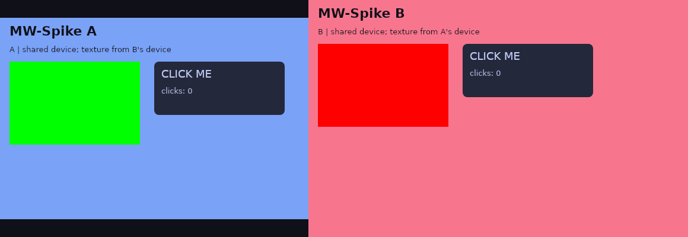
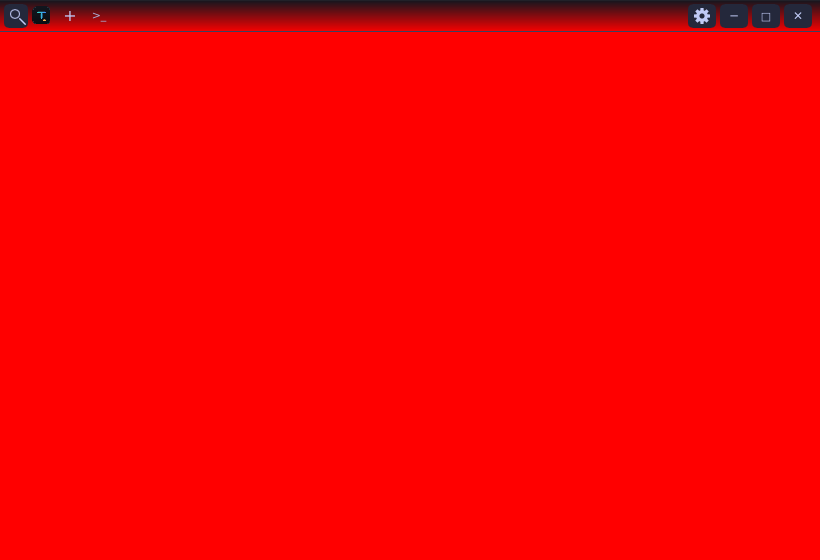

# 单进程多窗口 Spike（Slint 1.18.1 + WGPU30）

状态：**spike 完成，gate 通过（有条件）**  
分支：`agent/mw-spike`  
worktree：`.worktrees/mw-spike`  
基线：`9533f08`（当前 `main`，`docs: define single-process multi-window architecture and migration plan`）  
运行日期：2026-11-13  
范围：只回答“技术上能不能”，不改 `AppState`、PTY、插件、MCP、session、生产 UI。

---

## 0. 结论（TL;DR）

| # | 问题 | 结果 | 证据 |
|---|---|---|---|
| 1 | 同一 event loop 内两个独立 Window 组件实例？ | **可行** | 两个窗口独立 title/size/position/focus/callback；`xwininfo` + winit 事件 + per-window snapshot |
| 2 | 两个窗口共享同一 WGPU30 device/queue，各自独立 surface？ | **可行** | `same_device=true same_queue=true`；跨窗口创建/采样纹理；resize 互不影响；关 B 后 A 继续渲染，C 复用 A 的 device |
| 3 | 生产 `MainWindow` 能实例化两份，callback 捕获不同 window id？ | **可行** | `MainWindow` 未改一行 markup/Rust，两个实例同时显示；`id=A/B` callback 分别触发；`Palette`/`Lang` 甚至 per-instance |
| 4 | Slint 多窗口或共享 WGPU 失败？ | **未失败** | 真实失败只有环境/API 例外（软件 renderer 不支持 notifier、CPU WGPU 需 `SLINT_WGPU_CPU=1`、Xvfb 截不到 Vulkan surface） |

**Gate 判定：PASS（Slint/WGPU 层）→ 有条件 GO（产品集成层）。**

技术本身不需要 broker。上一代架构文档里“多进程 → primary+broker”的备选不是本 spike
的技术必需项；真正的阻塞点是 Tervo 自己的 GPU 全局状态（见 §5）和
`AppState`/WindowRuntime 重构，而不是 Slint/WGPU 能力。

---

## 1. 新增内容与边界

```text
crates/mw-spike/
  Cargo.toml            独立 spike crate；不依赖 tervo-app
  build.rs              只编译生产 crates/app/ui/main.slint（markup 不变）
  src/main.rs           三个模式：wgpu / software / mainwindow
  run_xvfb.sh           隔离 Xvfb + Openbox，跑模式并收集 X11/截图证据
docs/MULTI_WINDOW_SPIKE.md   本文
docs/evidence/mw-spike/      logs + per-window snapshots + X11 root capture
```

工作区只改了两处非生产配置：

- 根 `Cargo.toml` 增加 `crates/mw-spike` member（注释标明 spike only，`publish = false`）；
- `Cargo.lock` 增加 `mw-spike` 包。

**没有修改任何生产 Rust / Slint / 构建逻辑。** `crates/app/ui/main.slint` 由
spike 的 `build.rs` 原样编译，仅用于验证 `MainWindow` 能否多实例，不链接
`tervo-app`，也没有创建 `AppState`。

### 三个模式

| 模式 | renderer | 验证内容 |
|---|---|---|
| `wgpu` | Skia + WGPU30（`require_wgpu_30(Automatic)`） | 共享 device/queue、独立 surface、跨窗口纹理、resize/close 独立性 |
| `software` | `winit-software` | 无 GPU 时的多窗口 fallback baseline；同时记录 notifier 的 `Unsupported` |
| `mainwindow` | `winit-software` | 生产 `MainWindow` 组件双实例、callback、per-instance globals |

---

## 2. 复现命令

环境：本机无硬件 GPU，WGPU 只能用 llvmpipe（Vulkan CPU adapter）；无系统
`Xvfb` 时用仓库 `.perf/xvfb`。脚本拒绝 `:1` 和已被占用的 display。

```bash
cd /home/user/AIworkspace/rusttabbyterminal/.worktrees/mw-spike

export CARGO_HOME=$PWD/../../.cargo
export CARGO_TARGET_DIR=$PWD/../../target
export CARGO_NET_OFFLINE=true

cargo check -p mw-spike
cargo check --workspace
cargo build -p mw-spike

./crates/mw-spike/run_xvfb.sh wgpu
./crates/mw-spike/run_xvfb.sh software
./crates/mw-spike/run_xvfb.sh mainwindow
```

脚本默认 `DISPLAY=:88`、`hold-ms=12000`；`wgpu`/`software` 约 25 秒，
`mainwindow` 约 15 秒，不跑 soak。
输出覆盖写到 `docs/evidence/mw-spike/<mode>/`。`xwin` 助手默认
`target/debug/xwin`，缺失时脚本会给出构建命令。

关键日志：

```bash
grep -E "same_device|C device|RenderingTeardown|callback|focus:" \
    docs/evidence/mw-spike/wgpu/run.log
grep -E "globals|callback|snapshot" docs/evidence/mw-spike/mainwindow/run.log
```

---

## 3. Q1：同一 event loop 内两个独立 Window

### 实现

两个 `SpikeWindow` 组件在 `show()` 之后、单个 `slint::run_event_loop()` 之前创建。
每个实例有自己的：

- `Window` adapter / winit top-level；
- title（Slint `title` 属性）；
- `set_size` / `set_position` / `is_visible`；
- `set_rendering_notifier`；
- `on_poke` callback（闭包捕获不同 id）；
- `on_winit_window_event`（Focused/Resized/CloseRequested）。

### 结果

X11 树（`docs/evidence/mw-spike/wgpu/x11_windows.txt`）：

```text
0x20000f "MW-Spike A": ("mw-spike" "mw-spike")  520x340+40+40
0x200003 "MW-Spike B": ("mw-spike" "mw-spike")  640x400+620+40
```

外部激活 A/B 后，应用内 winit 事件（`run.log`）：

```text
[focus:A] focused=true
[focus:A] focused=false
[focus:B] focused=true
```

尺寸/位置：

```text
A: 520x340 +40+40    -> resize -> 480x300
B: 640x400 +620+40   -> resize -> 600x360
```

A resize 后 B 仍为 640x400；B resize 后 A 仍为 480x300。两个窗口的
`take_snapshot()` 尺寸也分别等于各自 client size。

Callback 各自触发：

```text
[callback] window=A msg="programmatic A"
[callback] window=B msg="programmatic B"
[callback] window=C msg="programmatic C"
```



*图：Slint `Window::take_snapshot()` 的两张独立快照拼接。WGPU/Vulkan surface 在
Xvfb 下不能被 XGetImage 截取（见 §4.3），所以这里不用 X11 root screenshot。*

**结论：Q1 = 可行。** 一个 event loop 管理多个独立 Slint Window 实例是官方支持的
常规用法，不需要额外 event loop 线程。

---

## 4. Q2：共享 WGPU30 device/queue，各自独立 surface

### 4.1 实测

两个窗口的 `RenderingSetup` 都拿到 `GraphicsAPI::WGPU30 { device, queue }`，
`wgpu::Device`/`Queue` 的 `PartialEq`（wgpu 30 内部按 dispatch handle 比较）：

```text
[gpu:A] RenderingSetup #1 adapter="llvmpipe (LLVM 15.0.7, 256 bits)" backend=Vulkan device_type=Cpu
[gpu:B] RenderingSetup #1 adapter="llvmpipe (LLVM 15.0.7, 256 bits)" backend=Vulkan device_type=Cpu
[gpu] cross-window identity: same_device=true same_queue=true same_adapter=true
[gpu] A setup=1 B setup=1
```

跨窗口纹理证明（不是“两个窗口各自创纹理”）：A 显示的绿色纹理是用 **B 的
device/queue** 创建并写入的；B 显示的红色纹理是用 **A 的 device/queue** 创建。
`take_snapshot()` 逐像素验证通过：

```text
[pixel] A frame (texture created on B's device) (126,144)=[0, 255, 0, 255] ok
[pixel] B frame (texture created on A's device) (126,144)=[255, 0, 0, 255] ok
```

### 4.2 resize / close 不互相丢 surface

关闭 B（`hide()` + drop 唯一 handle；Slint 的 WM close 默认也是 `hide()`，
见 §6.1-8，所以等价于关闭该顶层窗口）后：

```text
[close] closing B (A frames before close=8)
[gpu:B] RenderingTeardown #1
[close] after B closed: A frames=10 (was 8), B teardowns=1
[gpu:C] RenderingSetup #1 ... device_type=Cpu
[gpu] C device equals A device after B close: true
```

- B 的 teardown 只销毁 B 的 renderer/surface；
- A 的 frame 计数继续增长（8 → 10），

```text
[snapshot] A_after_B_closed 480x300
[pixel] A bg after B close ... ok
[pixel] A frame after B close ... [0, 255, 0, 255] ok
```

- 之后新建 C，`C.device == A.device`，C 也能显示用 A device 创建的蓝色纹理：

```text
[snapshot] C_after_B_closed 500x320
[pixel] C frame ... [0, 0, 255, 255] ok
[callback] window=C ...
```

### 4.3 Slint 内部机制（版本化证据）

Slint 1.18.1 的 Skia WGPU surface 把共享状态存在 `SkiaSharedContext` 上：

- `i-slint-renderer-skia-1.18.1/lib.rs:355`：
  `wgpu_30_state: RefCell<Weak<SharedWgpuState>>`
- `i-slint-renderer-skia-1.18.1/wgpu_30_surface.rs:183`：
  `SharedWgpuState { instance, adapter, device, queue }`
- `wgpu_30_surface.rs:263-310`：新窗口优先复用 `SharedWgpuState`，只
  `shared.instance.create_surface(...)` 创建自己的 `wgpu::Surface`；失败才重建 device。
- `i-slint-core-1.18.1/graphics/wgpu_30.rs:77`：如果应用要自己拥有 device，
  可用 `WGPUConfiguration::Manual { instance, adapter, device, queue }` 注入；
  每个窗口仍会创建独立 Surface。
- `i-slint-core-1.18.1/graphics/wgpu_30.rs:194`：无硬件 GPU 时必须
  `SLINT_WGPU_CPU=1` 才允许 CPU adapter。

因此产品当前使用的 `WGPUConfiguration::default()`（Automatic）已经自动跨窗口共享
device/queue，**不需要**为多窗口额外写 device 池。

**结论：Q2 = 可行。** 共享 device/queue、每窗口独立 surface、resize/close 独立，
均通过运行时证据。

spike 复用的是 app 现有的取 device 方式：`BackendSelector::require_wgpu_30(...)`
+ `Window::set_rendering_notifier` 的 `GraphicsAPI::WGPU30 { device, queue }`
（与 `crates/app/src/render_probe.rs` 相同）。它没有链接生产
`gpu_present`/`gpu_native`，避免把两者的全局静态状态带进 spike。

环境限制：Xvfb 下 Vulkan WSI 的像素不会被 XGetImage/X11grab 捕获（root 和单窗口
截图全黑），但 Slint `take_snapshot()` 正常；这不是多窗口问题，截图证据以
per-window snapshot 为准。

---

## 5. Q3：生产 `MainWindow` 双实例

### 5.1 实现

`crates/mw-spike/build.rs` 原样编译：

```text
crates/app/ui/main.slint
```

`run_mainwindow()` 创建两个 `app_ui::MainWindow::new()`，不创建 `AppState`：

```text
a.set_window_title("MW-Spike MainWindow A");
b.set_window_title("MW-Spike MainWindow B");
a.set_language("en");
b.set_language("zh");
a.on_new_tab(|| eprintln!("[callback] MainWindow id=A callback=new-tab"));
b.on_new_tab(|| eprintln!("[callback] MainWindow id=B callback=new-tab"));
a.show(); b.show();
```

### 5.2 结果

X11 树：

```text
0x200008 "MW-Spike MainWindow A": ("mw-spike" "mw-spike")  820x560+30+30
0x200003 "MW-Spike MainWindow B": ("mw-spike" "mw-spike")  700x480+870+30
```

Callback：

```text
[callback] MainWindow id=A callback=new-tab
[callback] MainWindow id=B callback=new-tab
```

`take_snapshot()` 的分辨率与各自 client size 一致：

```text
[snapshot] MainWindow_A 820x560
[snapshot] MainWindow_B 700x480
```




A 的整窗背景红色是 **故意的 Palette 隔离测试**：只改 A 的 `Palette.colors.bg`
为红色，B 保持默认 Tokyo Night。全局单例实测是 per-instance：

```text
[globals] Palette before A=... B=...; after write A=...red... B=...default...; shared=false
[globals] Lang A="en" B="zh" shared=false
```

这意味着：

- `Lang`/`Palette` 不会因为多窗口自动串台；每个窗口有一份；
- 但主题/语言切换必须由 `WindowRegistry` **逐窗口写入**，不能只改“全局”一次就
  以为所有窗口都更新。这是迁移时要显式处理的点，不是阻塞。

**结论：Q3 = 可行。** 未修改的 `MainWindow` 可以实例化两份，callback 闭包能正确
捕获不同 window id；不需要先接完整 `AppState`。

尚未验证：`MainWindow` × 2 + WGPU（本模式用 software）。WGPU 共享 device 已由
最小窗口验证；把两者组合是集成阶段第一项 e2e，预期不是技术风险，但不在本 spike
证据内。

---

## 6. Q4：失败/API 限制与集成 gate

### 6.1 实测到的具体限制

1. **软件 renderer 没有 rendering notifier**
   ```text
   [software] set_rendering_notifier returned Unsupported (expected Unsupported)
   ```
   软件多窗口本身正常（Q1 的 software 模式 PASS），只是拿不到 GPU API。
   生产 `render_probe::install` 已处理 `Unsupported`，不是新问题。

2. **WGPU 需要 CPU adapter 开关（本机）**
   缺少 `SLINT_WGPU_CPU=1` 时：
   ```text
   FAIL wgpu: require_wgpu_30/select failed: WGPU 30.x rendering was required but
   no GPU-backed WGPU adapter is available for the requested backends.
   Set SLINT_WGPU_CPU=1 to allow CPU adapters.
   ```
   完整日志：`docs/evidence/mw-spike/limits/wgpu_without_SLINT_WGPU_CPU.log`。
   本机 adapter 是 `llvmpipe`/Vulkan/Cpu，不是硬件 GPU 性能证据。

3. **Xvfb 截不到 Vulkan WSI surface**
   `xwd`/`x11grab` 的 X11 root/单窗口截图对 WGPU 窗口是全黑；Slint
   `Window::take_snapshot()` 正常。原因在 Xvfb 的 Vulkan WSI/呈现路径，不在
   Slint 多窗口；证据中已改用 per-window snapshot。

4. **`winit::Window::title()` 读回空字符串**
   `with_winit_window(|w| w.title())` 返回 `""`，但 X11 `xwininfo` 的
   `_NET_WM_NAME`/`WM_NAME` 是正确的 `MW-Spike A` / `MW-Spike B`。这是读回
   差异（原因未继续追）；实际窗口标题正确。产品不要用 winit `title()` 做窗口
   身份判断，应以自建 `WindowId` + Slint handle 注册表为准。

5. **Slint 1.19 未验证**
   当前工作区锁定 `slint = "=1.18.1"`；离线 registry 只有 1.18.1，1.19 不在
   依赖缓存中。本 spike 只对 **1.18.1** 做运行时断言，不声称 1.19 结果。
   使用的 API（`show`/`set_size`/`set_position`/`set_rendering_notifier`/
   `take_snapshot`/`WGPUConfiguration`）都是 1.18 公开 API，但 1.19 需在升级
   PR 中重跑同一 spike。

6. **必须是同一个 backend / 同一个 event loop**
   `BackendSelector` 是进程级选择；不能窗口 A 用 WGPU、窗口 B 用 software。
   所有窗口共享同一 Slint event loop；跨线程创建/操作窗口需
   `slint::invoke_from_event_loop`。这与单进程架构一致，但意味着
   “每窗口独立 renderer 类型”不可行。

7. **ComponentHandle 不是 `Clone`（1.18.1）**
   生成的组件类型没有实现 `Clone`；多窗口要持有多份句柄时用
   `ComponentHandle::clone_strong()`（spike 的 `a.clone_strong()`）。这不是
   多窗口限制，但会把只按单窗口写的 AppState/闭包代码暴露成编译错误。

8. **close 默认是 hide，不是销毁**
   Slint `CloseRequested` 默认 `Window::hide()`；最后一个可见窗口 hide 后
   `release_keepalive` 才退出 event loop
   （`i-slint-core-1.18.1/api.rs:753`、`context.rs:314-330`）。
   Tervo 必须自己监听 `on_close_requested`/窗口关闭，做 `WindowRuntime` 销毁、
   PTY 回收、session 更新；不能假设 drop window 会自动清理业务对象。

### 6.2 生产集成 gate（spike 之外，必须做）

这些不是 Slint 限制，但**会让“直接开两个 MainWindow”在生产里坏掉**：

1. **GPU 全局单例被多窗口踩踏**
   - `gpu_present::install`（`crates/app/src/gpu_present.rs:115`）是单一全局
     `STATE`；第二个窗口 `RenderingSetup` 会打印“丢弃旧 device 纹理”并清空
     `frames`（:125-130）。
   - `gpu_present::teardown`（:181）在**任意**窗口 teardown 时把全局
     `READY=false`、清空所有 pane 纹理。关 B 会让 A 掉回 CPU 路径。
   - `gpu_native::install`（`crates/app/src/gpu_native.rs:181`）同样每次 setup
     清空全局 atlas/target；`teardown`（:204）清所有窗口的 `PANE_IMAGES`；
     `retain(active)`（:215）按**单个窗口**的 active pane 列表回收，会误删另一
     窗口的 pane。
   - 修复方向：GPU 状态按 `WindowId` 分桶，或对 device/queue 做引用计数并只在
     最后一个窗口 teardown 时释放；`retain` 收全进程 active pane 并集。
     共享 device/queue 本身已经由 Slint 保证（§4）。
2. **`AppState` 仍是全局单例**：`with_app`、workspace、插件宿主、MCP、session
   写入器都是进程级；需要按 `docs/MULTI_WINDOW_ARCHITECTURE.md` 的
   `WindowRegistry` + `WindowRuntime` 拆分。spike 证明的是 Slint 窗口和 GPU
   资源可多实例，不是 `AppState` 已经可多实例。
3. **诊断计数器全局聚合**：`render_probe` 的 frames/backend label 是进程级；
   多窗口后需要 per-window 维度，否则 HUD/日志无法归因。
4. **主题/语言 per-instance**：如 §5.2，切换时必须遍历窗口写入。
5. **窗口身份 API**：不要用 winit `title()`；用自建 `WindowId` + Slint
   `Window` 指针/handle 注册表，并在 close 回调里移除。

### 6.3 是否推荐 broker？

**本 spike 不支持“必须 primary+broker”的结论。** Slint 多窗口和共享 WGPU
均可行，且已有可运行证据。推荐：

```text
首选：单进程多窗口（WindowRuntime）
  - 先修 gpu_present/gpu_native 的全局状态（引用计数或 per-window）
  - 再做 AppState → WindowRegistry/WindowRuntime 拆分
  - 最后接 MainWindow × N + WGPU e2e / 2m soak

备选（仅当 WindowRuntime 重构被否决）：
  primary + broker 多进程
  - 继续承担 config/plugin/MCP/session/GPU 的跨进程协调成本
  - 不是 Slint 能力所迫，而是组织/工期选择
```

---

## 7. 证据索引

`docs/evidence/mw-spike/`：

| 路径 | 内容 |
|---|---|
| `wgpu/run.log` | 完整 WGPU 双窗口运行日志（device 同一性、纹理、resize、close、C 复用） |
| `wgpu/x11_windows.txt` | 两个 top-level 的 X11 id/title/geometry |
| `wgpu/focus_A.txt` / `focus_B.txt` | `xwin --focus` 过程与 X11 树（当前 Xvfb/Openbox 无 EWMH `_NET_ACTIVE_WINDOW`，焦点以 winit 事件为准） |
| `wgpu/snapshots_side_by_side.png` | 两窗口 `take_snapshot()` 并排：A 绿纹理由 B device 创建，B 红纹理由 A device 创建 |
| `wgpu/snapshots_after_resize.png` | A 480x300 / B 600x360 独立 resize 后 |
| `wgpu/A_after_B_closed.png` | 关 B 后 A 仍正常渲染 |
| `wgpu/C_after_B_closed.png` | 关 B 后新建 C，复用 A 的 device |
| `software/run.log` + `desktop_both.png` | 无 GPU fallback 多窗口；`Unsupported` notifier 证据 |
| `mainwindow/run.log` | 生产 `MainWindow` 双实例、callback、globals 隔离 |
| `mainwindow/MainWindow_A.png` / `_B.png` | 两份 `MainWindow` 快照（A 红=Palette 隔离测试，B 默认主题） |
| `mainwindow/desktop_both.png` | X11 root 截图（软件渲染可见两窗） |
| `limits/wgpu_without_SLINT_WGPU_CPU.log` | 无 CPU adapter 时的精确报错 |

`x11_windows.txt` 中的 title 是外部 X11 属性，优先于 `winit::Window::title()` 的
空字符串读回（§6.1-4）。

---

## 8. 未做 / 后续

- 未接完整 `AppState`、PTY、插件、MCP、session（明确超出 spike 范围）。
- 未做 `MainWindow` × 2 + WGPU 组合；建议作为集成第一步。
- 未跑 2m/15m soak（任务明确不跑长 soak）；真正合并前按 AGENTS.md 跑 2m，
  触及渲染/循环后再按规模升级。
- 未验证 Slint 1.19、macOS/Windows、Wayland 多 surface、混合 DPI；这些需要在
  目标平台补测。
- 未改生产 `gpu_present`/`gpu_native`；§6.2 是后续工单输入，不是本分支的修复。

---

## 9. 结论

```text
Slint 1.18.1 单 event loop 双 Window：PASS
共享 WGPU30 device/queue + 独立 surface：PASS
生产 MainWindow 双实例 + 独立 callback：PASS
生产 GPU 全局状态直接多窗口：FAIL（spike 未改，见 §6.2）
→ 技术 gate PASS；产品化 CONDITIONAL GO，先做 GPU 状态/WindowRuntime 重构。
```
