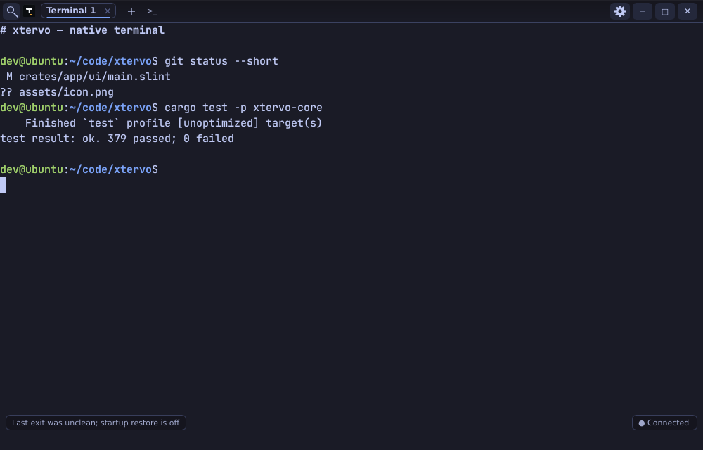

# xtervo

**A fast, light native terminal for Linux — Rust + Slint, GPU with software fallback.**

[Install](installation.md) · [Shortcuts](shortcuts.md) · [Plugins](plugins.md) · [简体中文](https://heytycho.github.io/xtervo/) · [GitHub](https://github.com/HeyTycho/xtervo)



> **How it is built**: this project is developed entirely by **DeepSeek + DeepSeek Harness**
> (code, tests and documentation). **Tested on** Ubuntu 22.04 / 24.04 only; other
> distributions and desktops are unverified. Bug reports and feature requests are welcome
> in [Issues](https://github.com/HeyTycho/xtervo/issues).

## Install

Prebuilt artifacts are published on [GitHub Releases](https://github.com/HeyTycho/xtervo/releases):

```bash
# tar.gz (installs to ~/.local by default)
tar xzf xtervo-<version>-linux-x86_64.tar.gz
./xtervo-<version>-linux-x86_64/install.sh

# or .deb
sudo apt install ./xtervo_<version>-1_amd64.deb

# verify downloads
sha256sum -c --ignore-missing SHA256SUMS
```

Building from source requires Rust 1.92+ and the X11 development libraries; see
[Installation](installation.md) for the full steps.

## Start here

- [Terminal behavior: bell, scrollback, Backspace/Delete](terminal-behavior.md)
- [Context menu and find](terminal-menu-find.md)
- [Terminal UI basics](terminal-ui-basics.md)
- [Themes: built-in, custom and imported palettes](themes.md)
- [SSH / SFTP](ssh-sftp.md) and [Vault](vault.md)
- [Plugins](plugins.md) and [Plugin API v3](plugin-api-v3.md)
- [MCP control](mcp.md) and [Diagnostics CLI](diagnostics.md)
- [FAQ](faq.md) · [Known limitations](known-limitations.md)

## Project

- [Changelog](https://github.com/HeyTycho/xtervo/blob/main/CHANGELOG.md) ·
  [Contributing](https://github.com/HeyTycho/xtervo/blob/main/CONTRIBUTING.en.md) ·
  [Security](https://github.com/HeyTycho/xtervo/blob/main/SECURITY.en.md)
- Design and status documents are currently maintained in Chinese under `docs/`;
  the [Chinese documentation site](https://heytycho.github.io/xtervo/) is the canonical
  reference for architecture, feature matrix and reports.

License: GPL-3.0-only.
